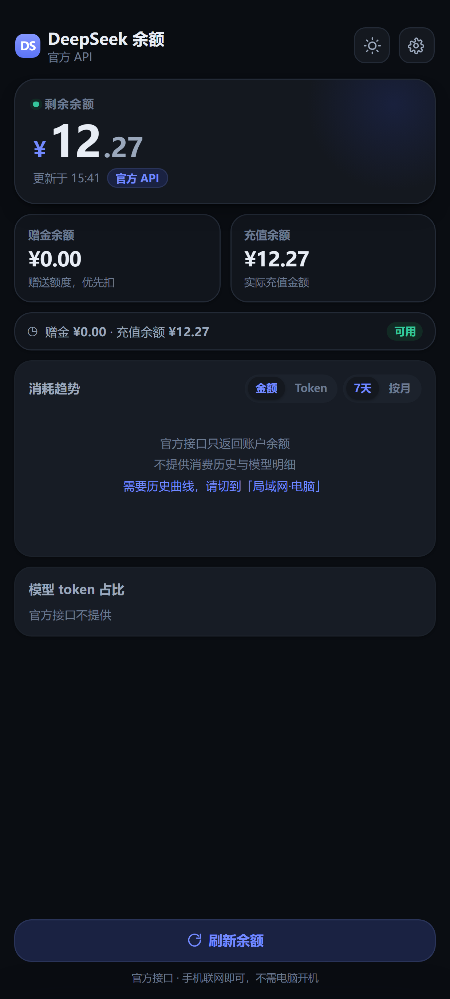

# DSH 余额 · DeepSeek Balance

在手机上随时查看 DeepSeek 账户余额——不用开电脑、不用登录网页、不用翻控制台。

<p align="center">
  
</p>

---

## 一、这个项目解决什么问题

### 原来的麻烦

DeepSeek 的余额没有一个随手能看的地方：

- **登录网页查** —— 要打开浏览器、登录、翻到账单页，来回七八步
- **API 控制台** —— 得开电脑，界面是给开发者用的，手机上很难点
- **根本看不见** —— 用着用着突然 402 报错才发现余额干了

### 这个项目做的

把「查余额」这件事变成**手机桌面上一眼就能看到**的数字：

| 痛点 | 解决方式 |
|---|---|
| 查余额步骤多 | 主屏点开即见，或直接看桌面小组件 |
| 必须开电脑 | **官方 API 模式完全不需要电脑**，手机联网即可 |
| 不知道还能撑几天 | 按历史日均算出「还够 3.7 天」，低于 7 天亮黄灯 |
| 切换 App 麻烦 | 桌面小组件 4×2 常驻，不打开 App 也能看 |
| 夜间刺眼 | 深色模式，字号自动小一号 |

### 顺带解决的一个小问题

如果你在用 [DSH](https://github.com/deepseek-ai) 这类本地 Agent 工具，它的账本（`~/.dsh/.dshw-usage.json`）里其实记着很详细的消费数据——每天花了多少、各个模型用了多少 token。这些数据本身很有用，但躺在电脑里没人看。**局域网模式**就是把它变成看得懂的图表。

---

## 二、主要功能

### 四种数据源，随时切换

| 数据源 | 电脑需开机 | 说明 |
|---|---|---|
| **局域网·电脑** | 是 | 读 DSH 本地账本，数据最全 |
| **官方 API Key** | **否** | 直连 DeepSeek 服务器，只要有 key |
| **自定义接口** | 视情况 | 中转站/自建代理，可配置字段路径 |
| 演示数据 | — | 内置静态数据，用于预览界面 |

### 界面

- **余额主卡** —— 大字显示剩余余额，带在线/离线状态
- **两张统计卡** —— 今日消耗 + 周期消耗（含日均与记录天数）
- **续航提示条** —— 按日均算出「还够 X 天」，低于 7 天亮黄灯并标「需充值」
- **消耗趋势图** —— 7 天（一天一根柱）或按月（一月一根柱），可切「金额 / Token」
- **模型 token 占比** —— 近 N 日各模型用量排名
- **点柱子看明细** —— 弹出当日/当月的扣费、token、模型分布

### 桌面小组件

4×2 卡片，显示余额 + 今日消耗 + 续航天数。

- **App 内点刷新** → 小组件立刻同步（不重复联网）
- **`AlarmManager` 定时** → 约 1 分钟一次
- **点小组件** → 自己联网刷新 + 打开 App

### 其他

- **深浅双主题** —— 跟随系统 / 手动切换，340ms 平滑过渡
- **离线快照** —— 连不上时显示上次数据，整卡转暖灰 + 标「离线快照」
- **UDP 自动发现** —— 电脑换 IP 也能找到，不用手填
- **崩溃截获** —— 出问题时显示完整堆栈而不是闪退

---

## 三、安装方法

### 方式 A：直接装 APK

1. 下载 `DSH余额.apk`（约 190 KB）
2. 传到手机，点击安装（提示「未知来源」时允许）
3. 打开 App → 右上角 ⚙ → 选数据源

**官方 API 模式（推荐，不需要电脑）**

```
⚙ → 数据来源 → 官方 API Key
→ 粘贴 sk- 开头的 key
→ 保存并刷新
```

key 在 [platform.deepseek.com](https://platform.deepseek.com) → **API keys** → 创建。

> **API Key 只存在你手机本地**（WebView localStorage），不上传、不写进安装包。

**局域网模式（要电脑配合）**

先在电脑上启动服务（见下），然后：

```
⚙ → 数据来源 → 局域网·电脑
→ 地址留空（App 会自动发现）
→ 保存并刷新
```

### 方式 B：电脑端服务（局域网模式需要）

只需要 Node.js，**零依赖**：

```bash
node balance-server.js        # 默认端口 8787
node balance-server.js 9000   # 自定义端口
PORT=9000 node balance-server.js
```

Windows 可双击 `启动余额服务.cmd`。

启动后终端会打印：

```
┌─────────────────────────────────────────────┐
│   DSH 余额服务已启动 ✓                      │
└─────────────────────────────────────────────┘

  当前余额  ¥12.28   今日消耗  ¥0.00
  模型窗口  2026-10-24 → 2026-10-30

  手机浏览器打开（要连同一个 WiFi）：

      http://192.168.1.10:8787

  ✓ 自动发现已开启（UDP 8788/应答 8789）
```

**首次使用需放行防火墙**（管理员终端）：

```powershell
netsh advfirewall firewall add rule name="DSH Balance" dir=in action=allow protocol=TCP localport=8787
```

### 方式 C：自行编译 APK

不需要 Gradle，纯 `aapt2 + ECJ + d8 + apksigner` 手工流水线。

**依赖**

- JDK 17+
- Android SDK build-tools **34** + platform **34**
- Node.js 18+
- [Eclipse ECJ](https://repo1.maven.org/maven2/org/eclipse/jdt/ecj/)（约 3 MB）

> 为什么必须用 ECJ：JDK 25 的 `javac` 产出的 class 文件，build-tools 34 里的 d8（R8 8.2）读不了，会抛 `NullPointerException`。ECJ 输出标准 Java 8 字节码，d8 完全认。

**准备 SDK**

```
android-sdk/
├── android-14/          ← build-tools 34
├── android-34/          ← platform 34
└── ecj.jar              ← Eclipse ECJ
```

放在 `apk/` 的同级目录（即项目根目录下）。

**配置**

```bash
cp apk/build-config.example.json apk/build-config.json
```

| 字段 | 说明 |
|---|---|
| `DSH_MODE` | 默认数据源，`api` 或 `lan` |
| `DSH_LAN` | 局域网候选地址（`\|` 分隔），留空用 UDP 自动发现 |

**构建**

```powershell
pwsh -File apk/build.ps1
```

产物：`apk/DSH余额.apk`

构建脚本有两道硬门禁：

- 编译只要有一个 `ERROR` 就中止 —— 不会产出缺类的残缺包（曾经因此出过闪退包）
- 扫描产物确认没有 `sk-` key 被误打进包

---

## 四、使用方法

### 打开就是余额

启动后自动刷新，显示：

- 大字余额（如 `¥12.28`）
- 今日消耗 / 周期消耗
- 续航提示（如「近 7 日均耗 ¥2.60 · 还够 4.7 天」）

### 切换周期

消耗趋势右上角：

- **7天** —— 一天一根柱
- **按月** —— 一月一根柱，固定显示最近 6 个月（无数据的月份留虚线空槽）

### 切换金额 / Token

趋势图左上：

- **金额** —— 每天花了多少钱
- **Token** —— 每天用了多少 token

### 看某一天/某月的明细

**点任意一根柱子**，弹出：

```
2026/10/24
当月扣费    ¥0.02
当月 token  211,422,217
模型分布    DeepSeek-V4.1-Flash  1.09 亿 · 51.4%
           DeepSeek-V4-Pro      1.03 亿 · 48.6%
```

### 切换主题

右上角太阳/月亮图标 —— 点一下直接切白天↔夜间。

「跟随系统」在 ⚙ 里。

### 刷新

- **点「刷新余额」** —— 转圈 → 数字闪一下 → 顶部提示「已更新 · 15:41」
- **切回前台** —— 自动刷新（非演示模式）
- **小组件点余额区** —— 自己联网刷新 + 打开 App

### 设置项

| 设置 | 可选项 |
|---|---|
| 外观 | 跟随系统 / 白天 / 夜间 |
| 数据来源 | 局域网·电脑 / 官方 API Key / 自定义接口 / 演示数据 |
| 电脑地址 | 手动填或留空自动发现，支持 `\|` 分隔多个 |
| API Key | `sk-` 开头 |
| 自定义接口 | URL + 可选 key + 可选字段路径 |

---

## 五、输入输出示例

### 1. 电脑端 HTTP 接口

#### `GET /api/ping` —— 健康检查

```json
{"ok":true,"service":"dsh-balance","port":8787}
```

#### `GET /api/balance` —— 余额与统计（真实输出，数据已截取）

```json
{
  "ok": true,
  "source": "dsh-ledger",
  "balance": 12.2758,
  "todayUsage": 0.0027,
  "date": "2026-10-30",
  "daysAvailable": 11,
  "window": "2026-10-24 → 2026-10-30",

  "history": {
    "2026-10-20": 0.1859,
    "2026-10-21": 5.0727,
    "2026-10-22": 15.0711
  },

  "tokensByDay": {
    "2026-10-20": 2520271,
    "2026-10-21": 117574658
  },

  "detailByDay": {
    "2026-10-24": {
      "tokens": 211422217,
      "models": [
        {"name": "DeepSeek-V4.1-Flash", "tokens": 108764611},
        {"name": "DeepSeek-V4-Pro", "tokens": 102657606}
      ]
    }
  },

  "months": ["2026-10"],
  "costByMonth": {"2026-10": 23.4346},
  "tokensByMonth": {"2026-10": 1011855172},

  "models": [
    {"name": "DeepSeek-V4.1-Flash", "tokens": 376796195, "pct": 60.3},
    {"name": "DeepSeek-V4-Pro", "tokens": 102657606, "pct": 16.4}
  ],
  "modelsByPeriod": {"7": [], "14": [], "30": []},
  "tokensByPeriod": {"7": 625000000, "14": 990000000, "30": 990000000}
}
```

**字段说明**

| 字段 | 类型 | 含义 |
|---|---|---|
| `balance` | number | 剩余余额（元） |
| `todayUsage` | number | 今日消耗（元） |
| `history` | object | 逐日扣费，键为 `YYYY-MM-DD`，最近 30 天 |
| `tokensByDay` | object | 逐日 token 用量 |
| `detailByDay` | object | 逐日的模型级明细 |
| `months` | array | 有数据的月份列表 |
| `costByMonth` | object | 逐月扣费合计 |
| `models` / `modelsByPeriod` | array | 模型 token 占比（按 7/14/30 天） |
| `daysAvailable` | number | 账本里有记录的总天数 |

#### `GET /` —— 网页版界面

直接返回 `dsh-balance.html`，手机浏览器也能用（不装 APK 的话）。

### 2. 官方 DeepSeek 接口

App 调用：`GET https://api.deepseek.com/user/balance`

**成功**（真实响应）

```json
{
  "is_available": true,
  "balance_infos": [
    {
      "currency": "CNY",
      "total_balance": "12.27",
      "granted_balance": "0.00",
      "topped_up_balance": "12.27"
    }
  ]
}
```

**失败**（key 无效）

```json
{
  "error": {
    "message": "Authentication Fails, Your api key: ****alid is invalid",
    "type": "authentication_error",
    "code": "invalid_request_error"
  }
}
```

App 界面上的对应关系：

| 官方字段 | 界面显示 |
|---|---|
| `total_balance` | 大字余额 `¥12.27` |
| `granted_balance` | 统计卡「赠金余额」 |
| `topped_up_balance` | 统计卡「充值余额」 |
| `is_available: false` | 提示条转黄 + 标「需充值」 |

> **官方接口只返回这三项**，没有消费历史、没有模型分布。这不是实现问题，是接口本身不提供。

### 3. 自定义接口模式

在 ⚙ 里填 URL + 可选 key + 可选字段路径。

**请求**

```http
GET https://your-proxy.example.com/user/balance
Authorization: Bearer sk-xxxxx        (可选)
Accept: application/json
```

**响应**（任意 JSON，App 会按下面顺序猜余额字段）

```
1. balance_infos.0.total_balance      ← 官方格式
2. data.balance
3. data.total_balance
4. total_balance
5. balance
6. data.quota
7. quota
8. data.remain
9. remain
10. data.available
```

都不匹配时，在设置里手动填「余额字段路径」，例如 `data.wallet.cny`。

### 4. UDP 自动发现

**电脑广播**（每 5 秒）

```json
{
  "service": "dsh-balance",
  "port": 8787,
  "ips": ["192.168.1.10"],
  "host": "DESKTOP-XXXX",
  "ts": 1793350000000
}
```

发往 `255.255.255.255:8788` 和 `x.x.x.255:8788`。

**App 主动问询**（启动时，比等广播快）

```json
{"service":"dsh-balance","ask":true}
```

发往 `255.255.255.255:8789`，电脑原地址回同样结构。

---

## 六、项目结构

```
├── dsh-balance.html          手机界面（单文件，也是 APK 的 assets）
├── balance-server.js         电脑端服务（零依赖）
├── 启动余额服务.cmd           Windows 一键启动
├── checkjs.mjs               JS 语法门禁
├── apk/
│   ├── AndroidManifest.xml
│   ├── build.ps1             PowerShell 构建流水线
│   ├── mkassets.mjs          注入配置到 assets
│   ├── build-config.example.json
│   ├── res/                  图标、小组件布局、双主题配色
│   └── src/com/dsh/balance/
│       ├── MainActivity.java   WebView 壳 + JS 桥
│       ├── Net.java            网络层（主程序与小组件共用）
│       ├── Discovery.java      UDP 自动发现
│       ├── WidgetProvider.java 桌面小组件
│       ├── WidgetAlarm.java    1 分钟定时刷新
│       ├── App.java            崩溃截获
│       └── CrashActivity.java  崩溃堆栈显示
└── screenshots/
```

---

## 七、设计说明

界面配色遵循「微差层次」——每层表面只差 1%–5% 亮度，靠微差堆叠层级而非强对比：

```
浅色  bg #F2F5FA → 主卡 #FFFFFF(+3.2%) → 次卡 #FBFCFE(+1.2%)
                → 内容卡 #F7F9FC(+1.5%) → 轨道 #F2F5F9(+2.0%)
深色  bg #0A0D12 → 主卡 #14181F(+3.0%) → 次卡 #11151C(+2.4%)
                → 内容卡 #171C25(+1.8%) → 轨道 #1C222C(+2.4%)
```

深色模式根字号 15px，浅色 16px —— 夜间整站字小一号，不会显得臃肿。

---

## 八、已知限制

- 官方接口不提供消费历史与模型分布（接口限制）
- 小组件 1 分钟定时在深度休眠时会被系统节流，厂商省电策略会进一步限制
- APK 用调试密钥签名，仅供个人使用，不适合上架应用商店
- 局域网模式依赖 DSH 的账本格式（`~/.dsh/.dshw-usage.json`），格式变了需要适配

---

## 九、许可

[MIT](LICENSE)
